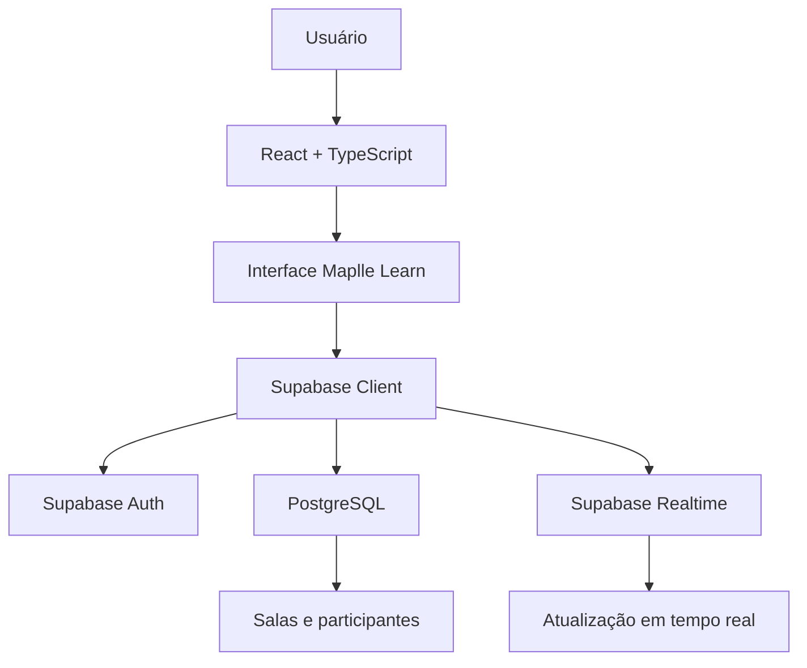

# ✨ Maplle Learn

### Aprenda francês. Conecte-se. Evolua jogando.

<p align="center">
  <strong>Uma nova maneira de aprender francês por meio de uma experiência interativa, social e gamificada.</strong>
</p>

<p align="center">
  
  
  
</p>

---

## 🌟 Sobre o projeto

O **Maplle Learn** é uma plataforma de aprendizagem de francês que busca tornar o processo de estudo mais dinâmico, envolvente e colaborativo.

A proposta é combinar aprendizado de idiomas com elementos de gamificação e interação entre usuários, criando um ambiente no qual aprender francês também seja uma experiência social.

A plataforma conta com **Maplle**, seu mascote e guia virtual, que representa a identidade do projeto e acompanha a experiência de aprendizagem.

## 🎯 Objetivos

- Tornar o aprendizado de francês mais acessível e interativo.
- Incentivar a prática por meio de experiências gamificadas.
- Promover a interação e a aprendizagem colaborativa.
- Criar uma experiência visual intuitiva e consistente.
- Desenvolver uma plataforma com estrutura preparada para novas funcionalidades.

## 🚀 Funcionalidades

### 🔐 Autenticação
- Cadastro e login com e-mail e senha.
- Autenticação com Google.
- Autenticação com GitHub.
- Gerenciamento de sessão com Supabase Auth.

### 🎮 Salas multiplayer
- Criação de salas privadas.
- Geração de códigos para compartilhamento.
- Entrada em salas por código.
- Identificação dos participantes.
- Sistema de status de prontidão (*Ready*).
- Controle de início da partida pelo anfitrião.
- Atualização dos dados das salas em tempo real.

### 🎨 Experiência visual
- Interface desenvolvida com identidade visual própria.
- Design responsivo e experiência intuitiva.
- Mascote Maplle integrado à identidade da plataforma.
- Elementos visuais inspirados em jogos e ambientes de aprendizagem.

## 🛠️ Tecnologias utilizadas

| Tecnologia | Aplicação |
|---|---|
| React | Construção da interface |
| TypeScript | Tipagem e segurança no desenvolvimento |
| Vite | Ambiente de desenvolvimento e build |
| CSS | Estilização e identidade visual |
| Supabase | Backend como serviço (BaaS) |
| Supabase Auth | Autenticação de usuários |
| PostgreSQL | Banco de dados |
| Supabase Realtime | Atualização de informações em tempo real |
| Lucide React | Biblioteca de ícones |

## 🏗️ Arquitetura

O projeto utiliza uma arquitetura baseada em frontend e serviços gerenciados pelo Supabase.



### Banco de dados

Entre as principais estruturas utilizadas estão:

- `profiles`: informações de perfil dos usuários.
- `rooms`: dados e estado das salas.
- `room_members`: participantes e status de prontidão.

A aplicação utiliza políticas de segurança em nível de linha (**Row Level Security — RLS**) e funções RPC para controlar operações importantes, como criação, entrada e gerenciamento de salas.

## ⚙️ Como executar o projeto

### 1. Pré-requisitos

- Node.js
- npm
- Git
- Projeto configurado no Supabase

### 2. Clone o repositório

```bash
git clone URL_DO_REPOSITORIO
cd maplle-learn
```

### 3. Instale as dependências

```bash
npm install
```

### 4. Configure as variáveis de ambiente

Crie um arquivo `.env` na raiz do projeto:

```env
VITE_SUPABASE_URL=sua_url_do_supabase
VITE_SUPABASE_ANON_KEY=sua_chave_publishable
```

> Utilize somente a chave pública `publishable` no frontend. Nunca exponha chaves secretas ou `service_role`.

### 5. Execute a aplicação

```bash
npm run dev
```

A aplicação estará disponível no endereço local informado pelo Vite, normalmente:

```text
http://localhost:5173
```

### 6. Gere a versão de produção

```bash
npm run build
```

## 🔒 Segurança

O Maplle Learn utiliza recursos de segurança do Supabase para proteger os dados e controlar o acesso às funcionalidades.

- Row Level Security (RLS).
- Controle de acesso baseado na autenticação.
- Funções RPC para operações controladas no banco.
- Variáveis de ambiente para configuração do cliente.
- Separação entre dados públicos e informações restritas dos usuários.

## 🗺️ Roadmap

- [x] Estrutura inicial da aplicação.
- [x] Interface de autenticação.
- [x] Integração com Supabase.
- [x] Autenticação por e-mail, Google e GitHub.
- [x] Criação e entrada em salas.
- [x] Gerenciamento de participantes.
- [x] Sistema de prontidão.
- [x] Sincronização de salas em tempo real.
- [ ] Desenvolvimento das experiências de aprendizagem.
- [ ] Implementação de desafios e atividades em francês.
- [ ] Sistema de pontuação e progressão.
- [ ] Expansão dos recursos de gamificação.

## 💡 Visão do projeto

O Maplle Learn nasceu da ideia de que aprender um novo idioma não precisa ser uma atividade solitária ou repetitiva.

Queremos transformar o aprendizado de francês em uma jornada mais interativa, colaborativa e divertida, aproximando tecnologia, educação e gamificação.

---

<p align="center">
  <strong>Maplle Learn</strong><br/>
  <em>Learn together. Grow together. Parlez français!</em>
</p>