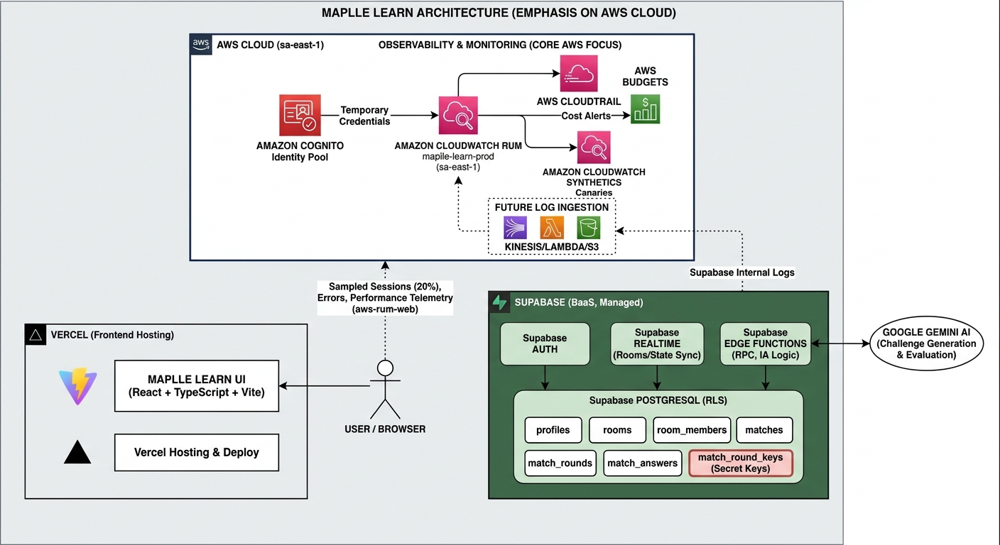
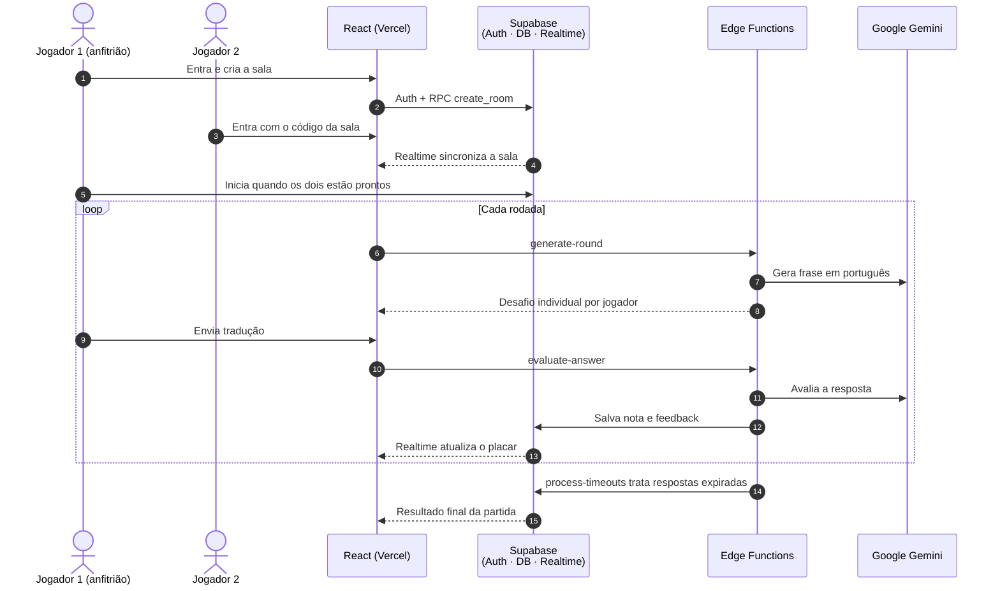

<div align="center">

# 🔮 Maplle Learn

### Aprenda francês e inglês. Conecte-se. Evolua jogando.

Uma plataforma **multiplayer** de aprendizagem de idiomas que transforma a prática de tradução em duelos sociais, competitivos e gamificados, com **IA** gerando desafios e corrigindo respostas em tempo real.

<br />

[](https://maplle-learn.vercel.app/)
[](docs/maplle-architecture.drawio.jpeg)

<br />

[](https://react.dev/)
[](https://www.typescriptlang.org/)
[](https://vite.dev/)
[](https://supabase.com/)
[](https://ai.google.dev/)
[](https://aws.amazon.com/cloudwatch/)
[](https://vercel.com/)

</div>

---

## 📑 Sumário

- [✨ Sobre o projeto](#-sobre-o-projeto)
- [🚀 Funcionalidades](#-funcionalidades)
- [🏗️ Arquitetura](#️-arquitetura)
- [🧰 Tecnologias](#-tecnologias)
- [📊 Observabilidade com AWS](#-observabilidade-com-aws)
- [🗃️ Dados e segurança](#️-dados-e-segurança)
- [⚙️ Executar localmente](#️-executar-localmente)
- [☁️ Deploy](#️-deploy)
- [🗺️ Roadmap](#️-roadmap)
- [💡 Visão do projeto](#-visão-do-projeto)

---

## ✨ Sobre o projeto

O **Maplle Learn** é construído em torno de **partidas entre duas pessoas**. Em vez de depender só de exercícios individuais, os participantes praticam tradução, recebem feedback imediato e acompanham a evolução em uma experiência multiplayer.

O mascote **Maplle**, uma bola de cristal caracterizada, é a identidade do produto e o guia visual da experiência.

| 🎯 O que acontece em uma partida | |
| :-- | :-- |
| 🇧🇷 **Origem** | Frases em português geradas por IA |
| 🇫🇷 🇬🇧 **Destino** | Cada jogador escolhe francês ou inglês |
| ⏱️ **Tempo** | Cronômetro por rodada, com tratamento de respostas expiradas |
| 🤖 **Avaliação** | Nota de 0 a 10, correção, explicação gramatical e traduções alternativas |
| 🏆 **Resultado** | Comparação das pontuações ao final da partida |

### 🎯 Objetivos

- Tornar a prática de idiomas mais **interativa e acessível**.
- Incentivar a **consistência** por meio de partidas e gamificação.
- Promover **aprendizagem colaborativa** entre amigos.
- Usar **IA** para gerar desafios e oferecer feedback contextualizado.
- Manter uma arquitetura **segura, observável e preparada para evoluir**.

---

## 🚀 Funcionalidades

<table>
<tr>
<td width="50%" valign="top">

### 🔐 Autenticação e perfil
- Cadastro e login com e-mail e senha
- Login social com **Google** e **GitHub**
- Sessões gerenciadas pelo Supabase Auth
- Perfil com nome de exibição, username e avatar

### 👥 Salas e amizades
- Salas privadas para até duas pessoas
- Código de sala para compartilhar e entrar
- Convites e gerenciamento de amizades
- Estado de prontidão dos participantes
- Sincronização de participantes e da sala

</td>
<td width="50%" valign="top">

### 🎮 Partidas multiplayer
- Respostas **simultâneas**: cada jogador recebe seu próprio desafio
- Idioma-alvo escolhido por participante (francês ou inglês)
- Rodadas e tempo de resposta configuráveis
- Controle de tempo, timeouts e desistência
- Resultado final com comparação de pontuações

### 🤖 Inteligência artificial
- Desafios gerados com **Google Gemini**
- Avaliação e feedback em português brasileiro
- Correções e traduções alternativas
- Base preparada para adaptação gradual de dificuldade

</td>
</tr>
</table>

### 🎨 Experiência visual

Interface própria em tons de roxo, layout responsivo, mascote Maplle integrado e ícones com Lucide React.

---

## 🏗️ Arquitetura

O frontend é uma aplicação **React/Vite** hospedada na **Vercel**. O **Supabase** fornece autenticação, banco de dados, políticas RLS, Realtime e Edge Functions, que coordenam a geração e a avaliação dos desafios com o **Google Gemini**. A telemetria de experiência real do navegador é enviada ao **AWS CloudWatch RUM**.

<div align="center">



<sub>Diagrama de arquitetura · <a href="docs/maplle-architecture.drawio">abrir o arquivo-fonte no draw.io / diagrams.net</a></sub>

</div>

### 🔄 Fluxo de uma partida



<details>
<summary><b>📋 Fluxo resumido em texto</b></summary>

<br />

1. O usuário acessa a aplicação na Vercel e autentica-se pelo Supabase Auth.
2. Os participantes criam ou entram em uma sala e ficam sincronizados pelo Supabase Realtime.
3. O anfitrião configura a partida e a inicia quando os dois jogadores estão prontos.
4. As Edge Functions geram um desafio individual para cada jogador, usando o Gemini.
5. Cada participante envia sua tradução; a função de avaliação valida a partida e pede a avaliação ao Gemini.
6. Respostas, pontuações e feedbacks são persistidos no Supabase e sincronizados entre os participantes.
7. Respostas expiradas passam pelo fluxo de timeout; ao final, o resultado da partida é calculado.

</details>

---

## 🧰 Tecnologias

| Camada | Tecnologia | Responsabilidade |
| :-- | :-- | :-- |
| 🖥️ **Frontend** | React + TypeScript | Interface e lógica do cliente |
| | Vite | Desenvolvimento e build |
| | CSS | Estilização e identidade visual |
| | Lucide React | Ícones da interface |
| ⚡ **Backend** | Supabase Auth | Autenticação e sessões |
| | Supabase PostgreSQL | Persistência dos dados |
| | Supabase RLS | Controle de acesso aos dados |
| | Supabase Realtime | Sincronização de salas e partidas |
| | Supabase Edge Functions | Operações de backend e integração com IA |
| | Supabase RPC | Operações transacionais e regras de negócio no banco |
| 🤖 **IA** | Google Gemini | Geração de desafios e avaliação de respostas |
| ☁️ **AWS** | CloudWatch RUM | Telemetria de experiência real no frontend |
| | Amazon Cognito Identity Pool | Credenciais temporárias para envio de eventos RUM |
| 🚀 **Deploy** | Vercel | Hospedagem e deploy do frontend |

---

## 📊 Observabilidade com AWS

O frontend utiliza o **Amazon CloudWatch Real User Monitoring (RUM)** para acompanhar a experiência de usuários reais na aplicação publicada. A integração usa o pacote [`aws-rum-web`](https://github.com/aws-observability/aws-rum-web), e o envio dos eventos é autorizado por um **Cognito Identity Pool** com credenciais temporárias.

### ✅ Implementado

| Configuração | Estado |
| :-- | :-- |
| App monitor | `maplle-learn-prod` |
| Região AWS | `sa-east-1` (São Paulo) |
| Amostragem de sessões | 20% |
| Performance telemetry | ✅ Ativada |
| JavaScript errors | ✅ Ativada |
| HTTP errors | ✅ Ativada |
| X-Ray tracing | ⛔ Desativado |
| Cookies do RUM | ⛔ Desativados |
| Autorização | Cognito Identity Pool com credenciais temporárias |

O RUM permite observar sessões amostradas, visualizações de página, indicadores de desempenho e erros capturados no navegador.

> [!NOTE]
> **Escopo atual:** o CloudWatch RUM monitora o frontend e as requisições observadas pelo navegador. Os logs de execução das Edge Functions, do Auth e do banco continuam nos recursos de observabilidade do próprio Supabase. A exportação desses logs para a AWS ainda não está configurada.

### 🔭 Próximas evoluções

- [ ] **AWS Budgets** para alertas de custo
- [ ] **CloudWatch Synthetics** para verificar disponibilidade e fluxos críticos
- [ ] **CloudTrail** para auditoria das atividades da conta AWS
- [ ] Avaliar integração dos logs do Supabase com um destino AWS (plano, custos e segurança)
- [ ] Avaliar rastreamento distribuído com X-Ray quando a arquitetura permitir

---

## 🗃️ Dados e segurança

<details>
<summary><b>🗄️ Principais estruturas do banco</b></summary>

<br />

| Estrutura | Finalidade |
| :-- | :-- |
| `profiles` | Dados públicos de perfil: nome, username e avatar |
| `rooms` | Salas, anfitrião, configurações e estado |
| `room_members` | Participantes e estado de prontidão |
| `matches` | Estado e configurações das partidas |
| `match_rounds` | Desafios individuais de cada participante |
| `match_answers` | Respostas, pontuações e feedbacks |
| `match_round_keys` | Referências e guias usados na avaliação, protegidos do acesso comum do cliente |

</details>

A aplicação utiliza:

- 🔒 **Row Level Security (RLS)** para restringir o acesso aos dados
- 🪪 **Supabase Auth** para identificar os usuários
- ⚙️ **RPCs** para operações sensíveis e transacionais
- 🧠 **Edge Functions** para operações de backend e chamadas à IA
- 🔑 **Variáveis de ambiente** para a configuração do cliente
- 🎟️ **Credenciais temporárias do Cognito** para o envio de telemetria RUM

> [!CAUTION]
> Nunca exponha `service_role`, chaves privadas do Gemini, credenciais IAM permanentes ou outros segredos no código do frontend, no repositório ou em variáveis `VITE_*`.

---

## ⚙️ Executar localmente

**Pré-requisitos:** Node.js (versão LTS recomendada), npm, Git e um projeto Supabase configurado e acessível.

```bash
# 1. Clonar o repositório
git clone URL_DO_REPOSITORIO
cd maplle-learn

# 2. Instalar dependências
npm install
```

**3. Configurar as variáveis de ambiente.** Crie um arquivo `.env` na raiz do projeto:

```env
VITE_SUPABASE_URL=sua_url_do_supabase
VITE_SUPABASE_ANON_KEY=sua_chave_publica
```

> [!IMPORTANT]
> Use apenas a chave **pública** do Supabase no frontend. As credenciais do Gemini e do Supabase usadas pelas Edge Functions devem ficar no ambiente seguro do Supabase.

```bash
# 4. Iniciar o ambiente de desenvolvimento
npm run dev

# 5. Validar o build de produção
npm run build
```

O Vite exibirá o endereço local, normalmente `http://localhost:5173`.

---

## ☁️ Deploy

O frontend está publicado na Vercel: **https://maplle-learn.vercel.app/**

- O deploy é feito a partir do repositório conectado à Vercel.
- As variáveis de ambiente necessárias são cadastradas nas configurações do projeto na plataforma.
- As **Supabase Edge Functions** e as alterações de banco são implantadas e gerenciadas no projeto Supabase.

---

## 🗺️ Roadmap

<table>
<tr>
<td width="50%" valign="top">

### ✅ Implementado

- [x] Estrutura inicial com React, TypeScript e Vite
- [x] Identidade visual e mascote Maplle
- [x] Autenticação por e-mail e provedores sociais
- [x] Perfis com avatar e username
- [x] Criação e entrada em salas privadas
- [x] Salas para dois participantes e estado de prontidão
- [x] Configuração de rodadas e tempo de resposta
- [x] Partidas com desafios individuais e respostas simultâneas
- [x] Geração de desafios com Gemini
- [x] Avaliação com pontuação e feedback
- [x] Persistência e sincronização do progresso da partida
- [x] Tratamento de timeout e desistência
- [x] Sistema de amizades e convites
- [x] Deploy do frontend na Vercel
- [x] Integração do AWS CloudWatch RUM em `sa-east-1`

</td>
<td width="50%" valign="top">

### 🔜 Próximos passos

- [ ] Evoluir métricas e alertas de observabilidade
- [ ] Configurar AWS Budgets
- [ ] Adicionar testes sintéticos de disponibilidade e fluxos críticos
- [ ] Avaliar exportação de logs do Supabase para uma plataforma externa
- [ ] Desenvolver chat entre amigos
- [ ] Criar desafios diários gerados por IA
- [ ] Evoluir progressão, histórico e estatísticas dos jogadores
- [ ] Avaliar rastreamento distribuído com AWS X-Ray

</td>
</tr>
</table>

---

## 💡 Visão do projeto

O Maplle Learn nasceu da ideia de que aprender um idioma não precisa ser uma atividade solitária ou repetitiva. Ao aproximar pessoas, desafios e inteligência artificial, o projeto busca transformar a prática em uma experiência compartilhada e motivadora.

A evolução técnica também faz parte da proposta: construir uma aplicação com autenticação, regras de acesso, operações de backend, sincronização em tempo real, deploy contínuo e observabilidade desde as etapas iniciais.

---

<div align="center">

**Maplle Learn**

*Learn together. Grow together. Parlez français!* 🔮

<sub>Desenvolvido por Breno</sub>

</div>
